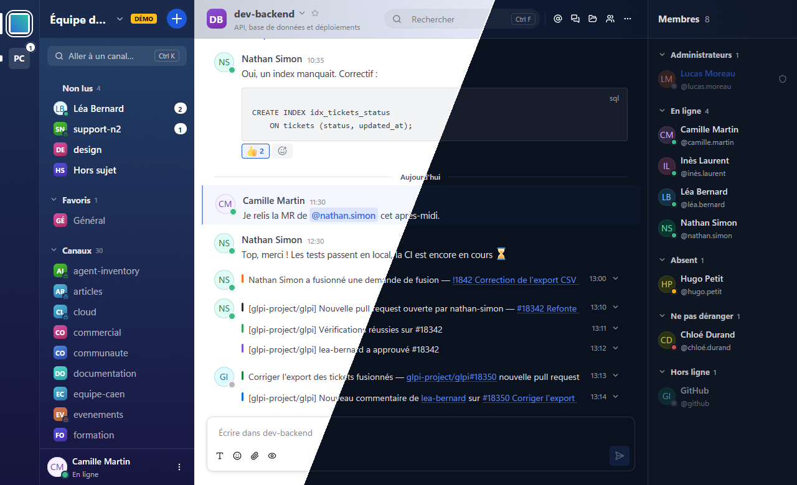

# mm-gpui

A native, lightweight desktop client for [Mattermost](https://mattermost.com),
written in Rust with [GPUI](https://gpui.rs), the UI engine behind Zed. No
Electron, no embedded browser.



## What it does

- Everyday Mattermost: your server's channels and categories, threads,
  reactions, attachments, search, mentions, direct messages.
- A fast interface that follows your Mattermost theme.
- Bot notifications (GitHub, GitLab…) condensed to one line each.
- Native notifications and badges, sign-in kept in the system keychain.

More details (in French) in [docs/FONCTIONNALITES.md](docs/FONCTIONNALITES.md).

## Install

Download the latest version from
[Releases](https://github.com/orthagh/mattermost_rust_client/releases):
Windows installer, macOS disk image, snap or flatpak for Linux.

Releases are not signed yet: Windows and macOS ask for confirmation on first
launch.

## Try it without a server

```bash
cargo run -- --demo
```

## Build

You need [Rust](https://rustup.rs) (stable). On Linux, a few system libraries
are required as well: see `packaging/linux-deps.sh`.

```bash
cargo build --release
cargo test
```

Changes for each version are listed in the [CHANGELOG](CHANGELOG.md).

## License

[MIT](LICENSE)
